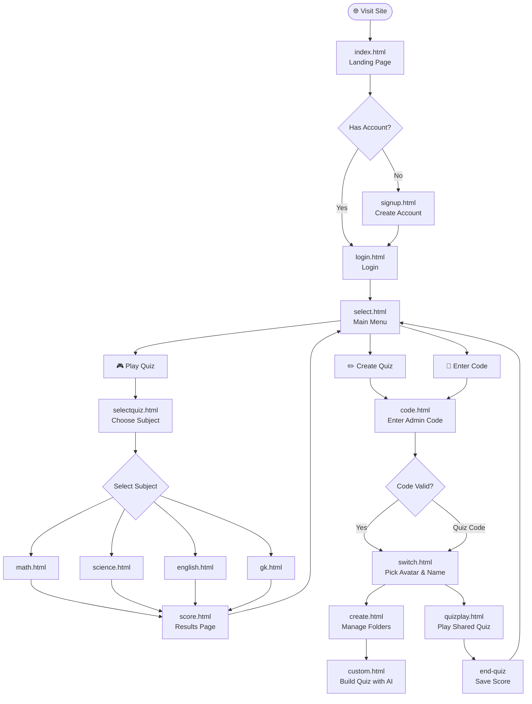
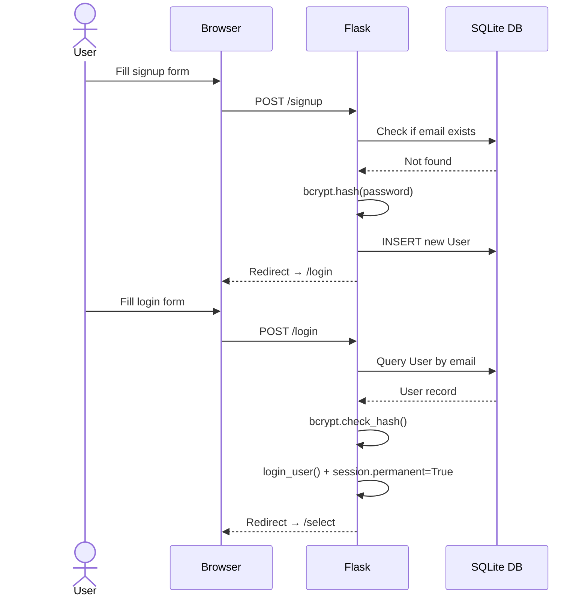
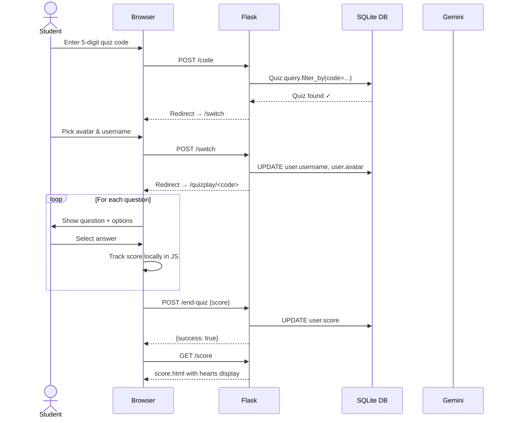
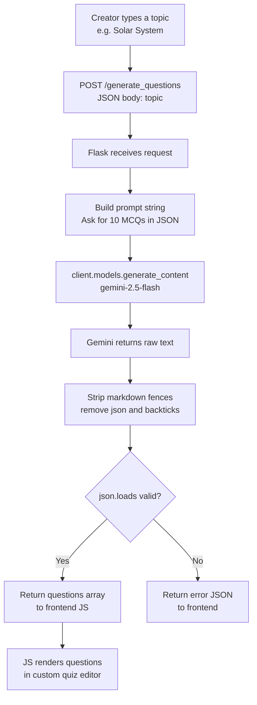
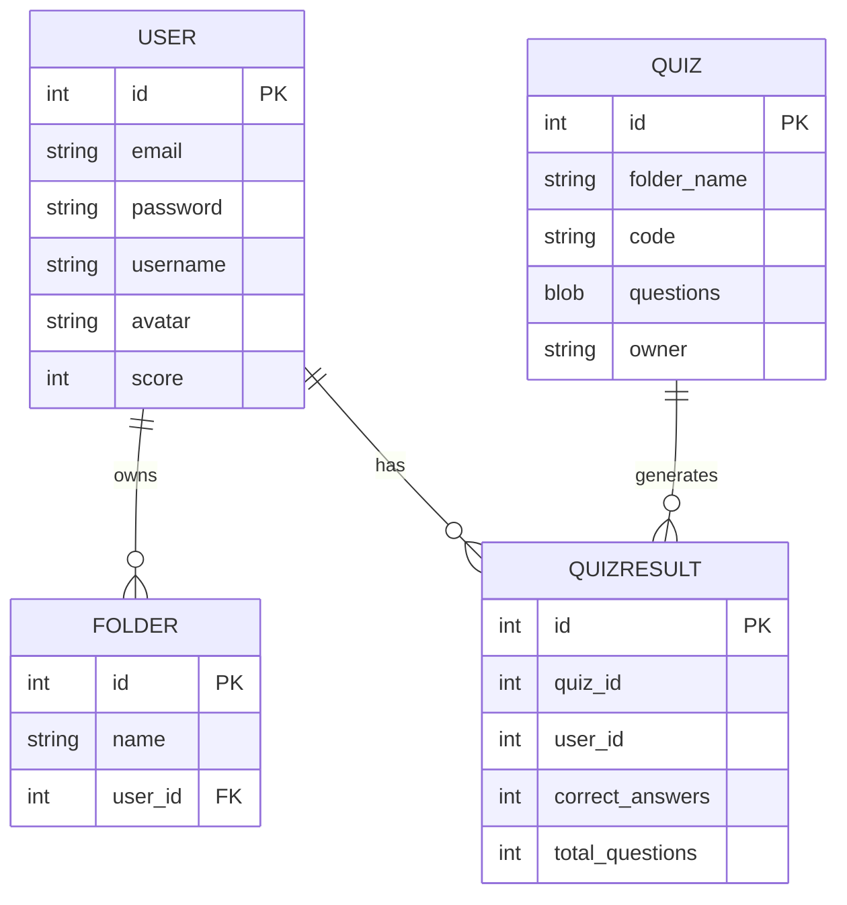
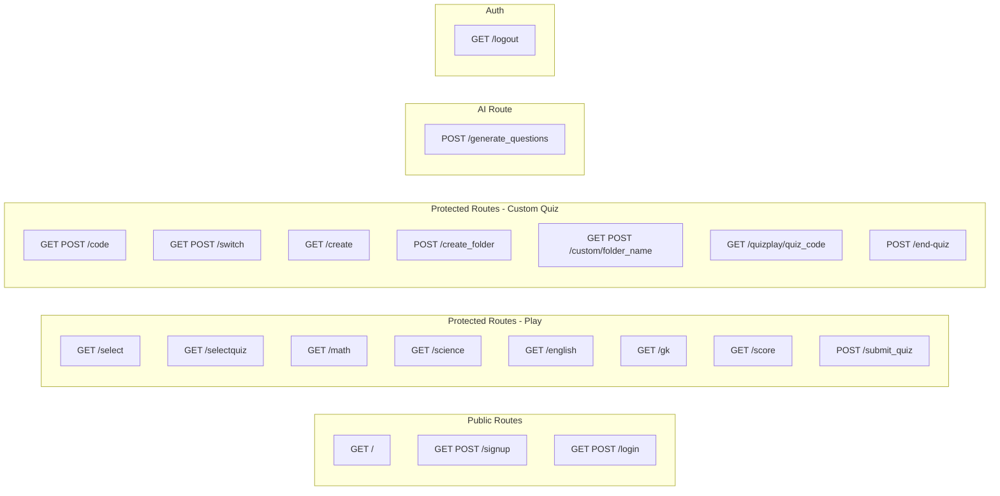

<div align="center">

# 🎮 Quizzio

### *A retro-styled, full-stack quiz web application built with Flask*

[](https://python.org)
[](https://flask.palletsprojects.com)
[](https://sqlite.org)
[](https://ai.google.dev)
[](LICENSE)

</div>

---

## 📖 Table of Contents

- [About](#-about)
- [Features](#-features)
- [Tech Stack](#️-tech-stack)
- [Application Flow](#-application-flow)
- [Database Schema](#️-database-schema)
- [Route Map](#-route-map)
- [Folder Structure](#-folder-structure)
- [Screenshots](#-screenshots)
- [Setup & Installation](#-setup--installation)
- [Environment Variables](#-environment-variables)
- [How to Use](#-how-to-use)
- [API Endpoints](#-api-endpoints)

---

## 🎯 About

**Quizzio** is a pixel-art themed, full-stack quiz platform where users can:
- Play **pre-built subject quizzes** (Math, Science, English, GK)
- **Create their own custom quizzes** using AI-generated questions powered by Google Gemini
- **Share** custom quizzes with friends via a unique 5-digit code
- **Track scores** and view results with a heart-based scoring system

The app has a distinctive retro pixel-art aesthetic with custom backgrounds, avatars, sound effects, and animations throughout the experience.

---

## ✨ Features

| Feature | Description |
|---|---|
| 🔐 **User Authentication** | Secure signup & login with bcrypt password hashing |
| 🎭 **Avatar & Username Selection** | Choose from 12 pixel-art avatars before each session |
| 📚 **Subject Quizzes** | Built-in quizzes for Math, Science, English & General Knowledge |
| 🤖 **AI Question Generation** | Generate quiz questions on any topic using Google Gemini 2.5 Flash |
| 📁 **Custom Quiz Folders** | Organise custom quizzes into named folders |
| 🔑 **Quiz Code Sharing** | Share quizzes via auto-generated unique 5-digit codes |
| 🕹️ **Quiz Play Mode** | Play shared quizzes question-by-question with live tracking |
| 💖 **Heart Score System** | Visual score display using filled/empty hearts |
| 🎵 **Sound Effects** | Click sounds and background audio for immersion |
| 💾 **Session Persistence** | Stay logged in for up to 5 days with Flask sessions |

---

## 🛠️ Tech Stack

| Layer | Technology |
|---|---|
| **Backend** | Python 3.10+, Flask 3.x |
| **Database** | SQLite via SQLAlchemy ORM |
| **Authentication** | Flask-Login, Flask-Bcrypt |
| **AI Integration** | Google Gemini 2.5 Flash (`google-genai`) |
| **Frontend** | HTML5, Vanilla CSS, JavaScript (ES6+) |
| **Templating** | Jinja2 |
| **Environment** | python-dotenv |
| **Font** | Press Start 2P (Google Fonts) |

---

## 🔄 Application Flow

### Overall User Journey



---

### Authentication Flow



---

### Custom Quiz Creation Flow

```mermaid
flowchart LR
    A[Teacher/Creator\nenters code 00000] --> B[switch.html\nPick avatar + name]
    B --> C[create.html\nView folders]
    C --> D[Create new folder\nPOST /create_folder]
    D --> E[custom.html\nFolder workspace]
    E --> F{Add questions}
    F -- Manual --> G[Fill in question\noptions & answer]
    F -- AI-Powered --> H[POST /generate_questions\nwith topic]
    H --> I[Gemini 2.5 Flash\ngenerates 10 MCQs]
    I --> G
    G --> J[Save quiz\nPOST /custom/folder_name]
    J --> K[Unique 5-digit\ncode generated]
    K --> L[Share code\nwith students]
```



---

### Quiz Play Flow (Shared Quiz via Code)



---

### AI Question Generation Flow



---

## 🗄️ Database Schema



---

## 🗺️ Route Map



---

## 📁 Folder Structure

```
Quizzio-Flask/
│
├── app.py                        # Main Flask application — all routes, models, logic
├── requirements.txt              # Python dependencies
├── .env                          # Environment variables (not committed)
├── .gitignore
│
├── instance/
│   └── users.db                  # SQLite database (auto-created)
│
├── templates/                    # Jinja2 HTML templates
│   ├── index.html                # Landing page
│   ├── signup.html               # User registration
│   ├── login.html                # User login
│   ├── select.html               # Main menu (Play / Create)
│   ├── selectquiz.html           # Choose subject quiz
│   ├── math.html                 # Math quiz
│   ├── science.html              # Science quiz
│   ├── english.html              # English quiz
│   ├── gk.html                   # General Knowledge quiz
│   ├── score.html                # Results page with hearts
│   ├── code.html                 # Enter quiz/admin code
│   ├── switch.html               # Avatar & username picker
│   ├── create.html               # Folder manager for custom quizzes
│   ├── custom.html               # Custom quiz builder
│   └── quizplay.html             # Play a shared quiz
│
└── static/
    ├── css/                      # Stylesheets per page
    │   ├── login.css
    │   ├── create.css
    │   ├── score.css
    │   └── ...
    ├── js/                       # Page-specific JavaScript
    │   ├── create.js             # Folder creation via fetch API
    │   ├── custom.js             # Quiz builder + AI generation
    │   ├── math.js / science.js  # Built-in quiz logic
    │   ├── switch.js             # Avatar selection UI
    │   ├── score.js              # Score animation
    │   └── ...
    ├── images/                   # Backgrounds, avatars, UI elements
    │   ├── avatar1.png → avatar12.png
    │   ├── login.png
    │   ├── logo.png
    │   ├── colored_heart.png
    │   ├── empty_heart.png
    │   └── ...
    └── audio/                    # Sound effects
        └── click2.wav
```

---

## 📸 Screenshots

> 🖼️ *Replace each placeholder below with an actual screenshot after deployment.*

### Landing Page

> *The animated retro-style landing page introducing Quizzio.*

---

### Signup & Login

> *User registration form with pixel-art background.*


> *Login page with flash message feedback.*

---

### Main Menu

> *The main menu where users choose between playing or creating a quiz.*

---

### Avatar & Username Selection

> *Avatar picker — choose from 12 pixel-art characters before starting.*

---

### Subject Quiz

> *A built-in subject quiz in action — one question at a time.*

---

### Score Page

> *Results screen showing filled/empty hearts representing correct answers.*

---

### Custom Quiz Creator

> *Folder manager for organising custom quizzes.*


> *The AI-powered quiz builder — enter a topic, Gemini generates 10 MCQs instantly.*

---

### Shared Quiz Play

> *Playing a shared quiz after entering a 5-digit code.*

---

## ⚙️ Setup & Installation

### Prerequisites

- Python 3.10 or higher
- `pip`
- A Google Gemini API key ([get one here](https://aistudio.google.com/app/apikey))

### Steps

```bash
# 1. Clone the repository
git clone https://github.com/Poorvikab/Quizzio-Flask.git
cd Quizzio-Flask

# 2. Create and activate a virtual environment
python -m venv venv

# Windows
venv\Scripts\activate

# macOS / Linux
source venv/bin/activate

# 3. Install dependencies
pip install -r requirements.txt
pip install google-genai          # New Gemini SDK

# 4. Create your .env file (see section below)

# 5. Run the app
python app.py
```

The app will be available at **http://127.0.0.1:5000**

> The SQLite database (`users.db`) is created automatically on first run via `db.create_all()`.

---

## 🔐 Environment Variables

Create a `.env` file in the project root:

```env
GEMINI_API_KEY=your_google_gemini_api_key_here
```

| Variable | Description | Required |
|---|---|---|
| `GEMINI_API_KEY` | Google Gemini API key for AI question generation | ✅ Yes |

> ⚠️ Never commit your `.env` file. It is already listed in `.gitignore`.

---

## 📘 How to Use

### As a Student / Player

1. **Sign up** and **log in**
2. Go to **Select** → choose **Play Quiz**
3. Pick a subject (Math, Science, English, GK)
4. Select your **avatar and username**
5. Answer all questions and view your **score with hearts**

**OR — play a shared quiz:**

1. Go to **Select** → **Enter Code**
2. Type the **5-digit code** shared by your teacher/friend
3. Pick your avatar and play!

---

### As a Teacher / Creator

1. Log in and go to **Select** → **Create Quiz**
2. Enter the **admin code: `00000`**
3. Pick an avatar and go to your **folder manager**
4. **Create a new folder** (quiz set)
5. Inside the folder:
   - **Manually add** questions, options, and correct answers
   - Or type a **topic** and let **Gemini AI generate 10 questions** instantly
6. **Save** the quiz — a unique **5-digit code** is generated
7. **Share the code** with students!

---

## 🌐 API Endpoints

| Method | Route | Auth | Description |
|---|---|---|---|
| `GET` | `/` | ❌ | Landing page |
| `GET POST` | `/signup` | ❌ | User registration |
| `GET POST` | `/login` | ❌ | User login |
| `GET` | `/logout` | ✅ | Logout user |
| `GET` | `/select` | ✅ | Main menu |
| `GET` | `/selectquiz` | ✅ | Subject selection |
| `GET` | `/math` | ✅ | Math quiz page |
| `GET` | `/science` | ✅ | Science quiz page |
| `GET` | `/english` | ✅ | English quiz page |
| `GET` | `/gk` | ✅ | General Knowledge quiz page |
| `GET` | `/score` | ✅ | Score results page |
| `POST` | `/submit_quiz` | ✅ | Save score from built-in quiz |
| `GET POST` | `/code` | ✅ | Enter quiz/admin code |
| `GET POST` | `/switch` | ✅ | Avatar & username selection |
| `GET` | `/create` | ✅ | Folder manager |
| `POST` | `/create_folder` | ✅ | Create a new quiz folder |
| `GET POST` | `/custom/<folder_name>` | ✅ | Quiz builder for a folder |
| `POST` | `/generate_questions` | ❌ | AI question generation via Gemini |
| `GET` | `/quizplay/<quiz_code>` | ✅ | Play a shared quiz |
| `POST` | `/end-quiz` | ✅ | Save score from shared quiz |

---

## 👩‍💻 Author

**Poorvika B**
- GitHub: [@Poorvikab](https://github.com/Poorvikab)
- Project: [Quizzio-Flask](https://github.com/Poorvikab/Quizzio-Flask)

---

<div align="center">
  Made with ❤️ and lots of pixel art
</div>
